# Ph-UI!!!

<details>
	<summary><strong>Instructions for Students (Click to Expand)</strong></summary>
  
	**Submission Cleanup Reminder:**
	- This README.md contains extra instructional text for guidance.
	- Before submitting, remove all instructional text and example prompts from this file.
	- You may delete these sections or use the toggle/hide feature in VS Code to collapse them for a cleaner look.
	- Your final submission should be neat, focused on your own work, and easy to read for grading.
  
	This helps ensure your README.md is clear, professional, and uniquely yours!
</details>

---

---

## Lab Overview

Members: Rohil Saraf, Andreas Kilbinger

For lab this week, we focus on both sensing and actuation, bringing new modes of input and output into your devices, while also prototyping the physical structure and overall look of the device. You will consider how the physical form supports sensing and actuation, and how these elements come together to shape the interaction and aesthetics of the device.

---

## Lab Structure

A) [Capacitive Sensing](#part-a)

B) [More Sensors](#part-b)

C) [Servo Actuation](#part-c)

D) [Physical Interaction Design: Feast Automata](#part-d)

E) [Build & Integrate](#part-e)

F) [Final Documentation](#part-f)

---

## Part 1 Lab Preparation

---

### Get the latest content:

As always, pull updates from the class Interactive-Lab-Hub to both your Pi and your own GitHub repo. As we discussed in the class, there are 3 ways you can do so:

Option 1: On the Pi, `cd` to your `Interactive-Lab-Hub`, pull the updates from upstream (class lab-hub) and push the updates back to your own GitHub repo. You will need the personal access token for this.

```
pi@ixe00:~$ cd Interactive-Lab-Hub
pi@ixe00:~/Interactive-Lab-Hub $ git pull upstream Fall2026
pi@ixe00:~/Interactive-Lab-Hub $ git add .
pi@ixe00:~/Interactive-Lab-Hub $ git commit -m "get lab4 content"
pi@ixe00:~/Interactive-Lab-Hub $ git push
```

Option 2: On your own GitHub repo, [create pull request](https://github.com/FAR-Lab/Developing-and-Designing-Interactive-Devices/blob/2021Fall/readings/Submitting%20Labs.md) to get updates from the class Interactive-Lab-Hub. After you have latest updates online, go on your Pi, `cd` to your `Interactive-Lab-Hub` and use `git pull` to get updates from your own GitHub repo.

Option 3: (preferred) use the Github.com interface to update the changes.

---

### Quick Start: Python Environment Setup

1. **Create and activate a virtual environment in Lab 4:**
   ```bash
   cd ~/Interactive-Lab-Hub/Lab\ 4
   python3 -m venv .venv
   source .venv/bin/activate
   ```
2. **Install all Lab 4 requirements:**
   ```bash
   pip install -r requirements2025.txt
   ```
3. **Check CircuitPython Blinka installation:**
   ```bash
   python blinkatest.py
   ```
   If you see "Hello blinka!", your setup is correct. If not, follow the troubleshooting steps in the file or ask for help.

---

### Gathering materials for this lab:

- Cardboard (start collecting those shipping boxes!)
- Found objects and materials--like bananas and twigs.
- Cutting board
- Cutting tools
- Markers

(We do offer shared cutting board, cutting tools, and markers on the class cart during the lab, so do not worry if you don't have them!)

---

### Prototyping References

- [What do prototypes prototype?](https://www.semanticscholar.org/paper/What-do-Prototypes-Prototype-Houde-Hill/30bc6125fab9d9b2d5854223aeea7900a218f149)
- [Paper prototyping](https://www.uxpin.com/studio/blog/paper-prototyping-the-practical-beginners-guide/) is used by UX designers to quickly develop interface ideas and run them by people before any programming occurs.
- [Cardboard prototypes](https://www.youtube.com/watch?v=k_9Q-KDSb9o) help interactive product designers to work through additional issues, like how big something should be, how it could be carried, where it would sit.
- [Tips to Cut, Fold, Mold and Papier-Mache Cardboard](https://makezine.com/2016/04/21/working-with-cardboard-tips-cut-fold-mold-papier-mache/) from Make Magazine.
- [Surprisingly complicated forms](https://www.pinterest.com/pin/50032245843343100/) can be built with paper, cardstock or cardboard. The most advanced and challenging prototypes to prototype with paper are [cardboard mechanisms](https://www.pinterest.com/helgangchin/paper-mechanisms/) which move and change.
- [Dyson Vacuum Cardboard Prototypes](http://media.dyson.com/downloads/JDF/JDF_Prim_poster05.pdf)
<p align="center"> </p>

### Feast Automata Inspirations

- [Simone Giertz - The Breakfast Machine](https://www.youtube.com/watch?v=E2evC2xTNWg) turns an everyday breakfast routine into a deliberately awkward robotic performance.
- [Pee-wee’s Big Adventure - Breakfast Machine](https://www.classhook.com/resources/1295-pee-wee-s-big-adventure-pee-wee-s-breakfast-machine?utm_source=chatgpt.com) An elaborate Rube Goldberg-style machine turns the ordinary routine of making breakfast into a playful mechanical performance.
- [Wallace & Gromit - The Autochef](https://www.google.com/search?sca_esv=66d2cd5ecf989ed9&sxsrf=APpeQnuwAWHrA3R0b1GeoQ4r-spKos3vUQ:1789367781228&udm=7&fbs=ABfTbFVyMZGZf1hfvX9uKjN_-G8cxpBkeIeqYwoCbfNVc4vKE7plZzta63Pe5DpJ3XFR9XzI_yj6fb6bfPt1x_5u3nRcG7tR9jg4Omd7-UnDuaw5i86wRQqe-045kPXObjb1eDS649ikhB0y_hSFYfNioDnA60A2i_oC1IzIZywb7ERnDQqnSx10JnfJEaAauzJXglx4123_vjf0_54bKrF6QjM9ne5i3g&q=Wallace+%26+Gromit+%E2%80%94+The+Autochef&sa=X&ved=2ahUKEwiI0OO3uu2WAxVHEFkFHQ3iAOEQtKgLegQIFRAB&biw=1197&bih=613&dpr=2.5#fpstate=ive&vld=cid:72c3eb07,vid:2igRcGxlshA,st:0)
- [Nik Ramage - Jelly Wobbler](http://www.youtube.com/watch?v=pj2t71q68sY#t=33) makes the simple act of wobbling jelly into a dedicated machine.
- [Zekun Chang - Blah Blah](https://zekunchang.com/portfolio/blah-blah/) is an alcohol machine that presents a playful commentary on drunken behavior.

### Mechanical Prototyping Resource

- [Gear Template Generator](https://woodgears.ca/gear_cutting/template.html) can help you prototype simple gear mechanisms for translating servo motion into physical movement.

---

## Part A. Capacitive Sensing

I connected the MPR121 capacitive sensor to the Pi with a Qwiic cable. Running `i2cdetect -y 1` showed it at address `0x5a`. I clipped **_ (objects) to pads _** with alligator clips and ran `cap_test.py`. Touching each object printed the matching pad number, so the sensor works.

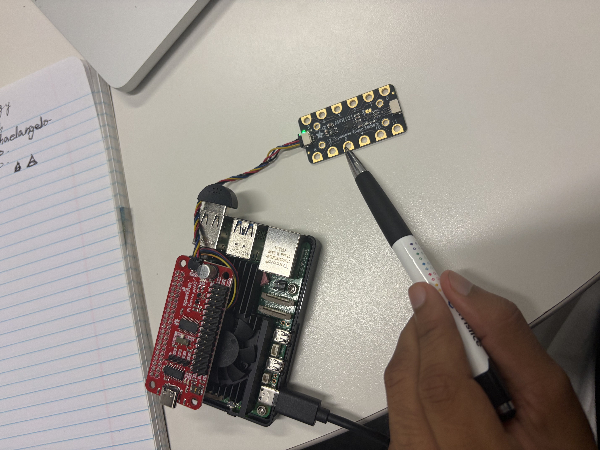 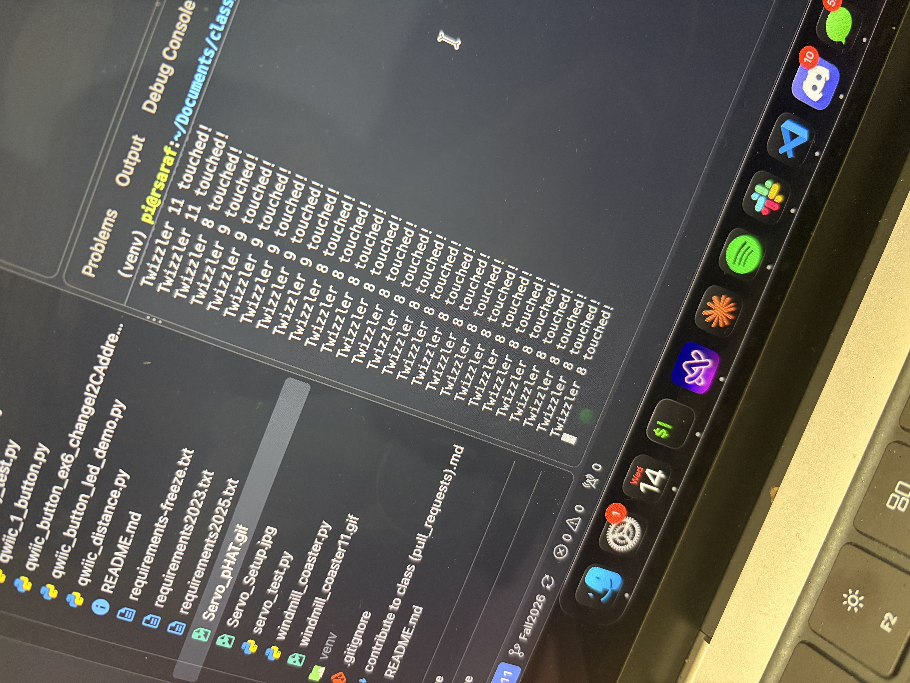

---

## Part B. More Sensors

I tested each sensor one at a time. I shut the Pi down before plugging in each new board, then checked its address with `i2cdetect -y 1`.

### Light / proximity / gesture sensor (APDS-9960, `0x39`)

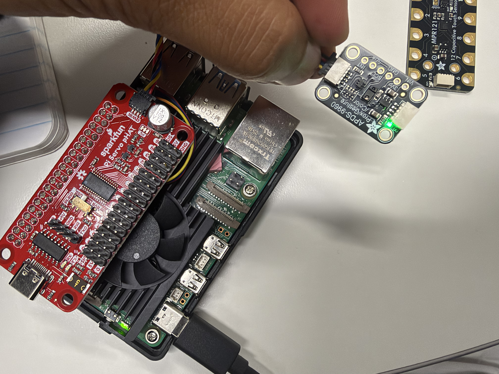

- **Proximity:** about **_ with nothing near it, up to about _** when my hand was right above it. It only reacts within a few cm.
- **Gesture:** \_\_\_ (which directions worked, how close you had to be)
- **Color/light:** about **_ lux in the room, about _** when I covered it.

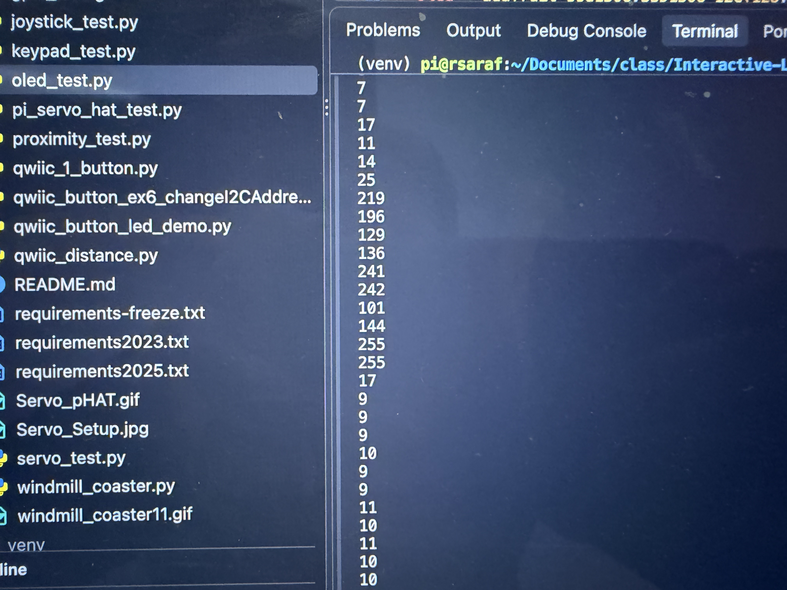 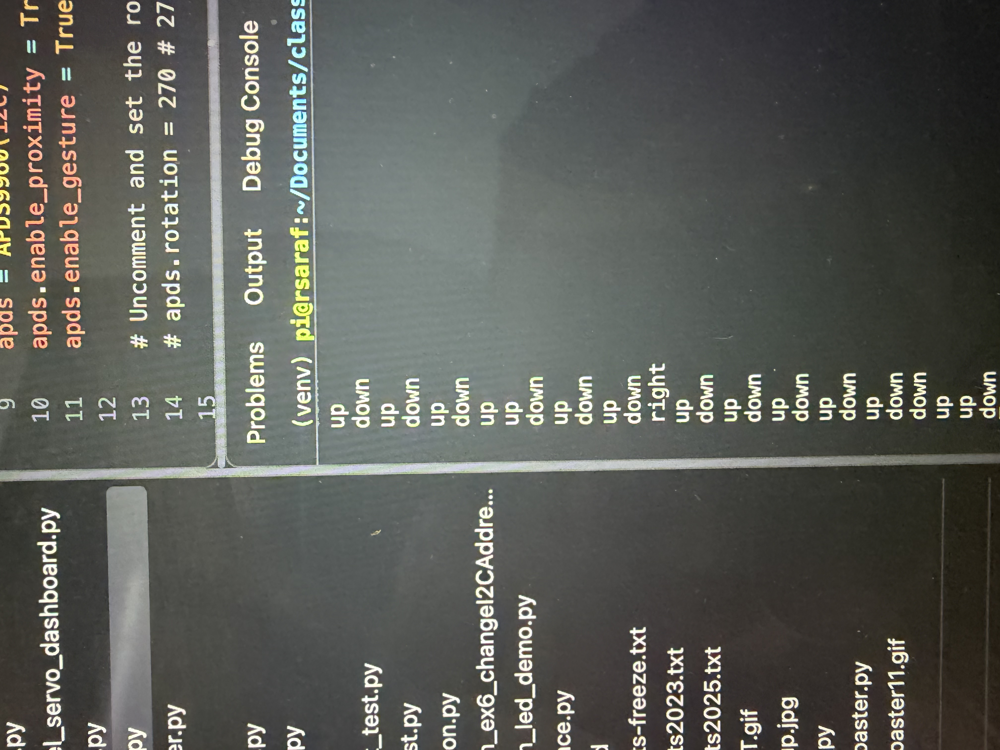 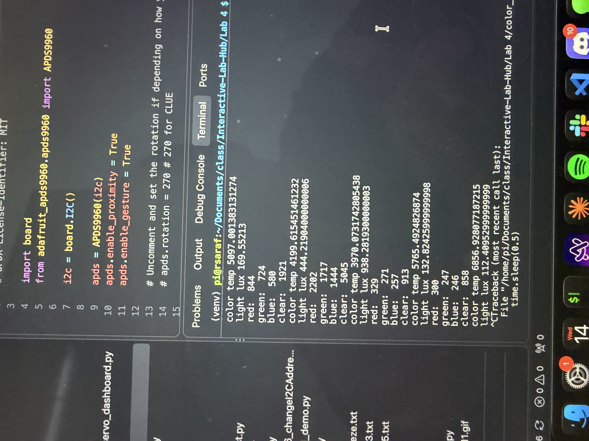

### Rotary encoder (`0x36`)

The position went up and down as I turned the knob each way, and pressing it printed the button press.

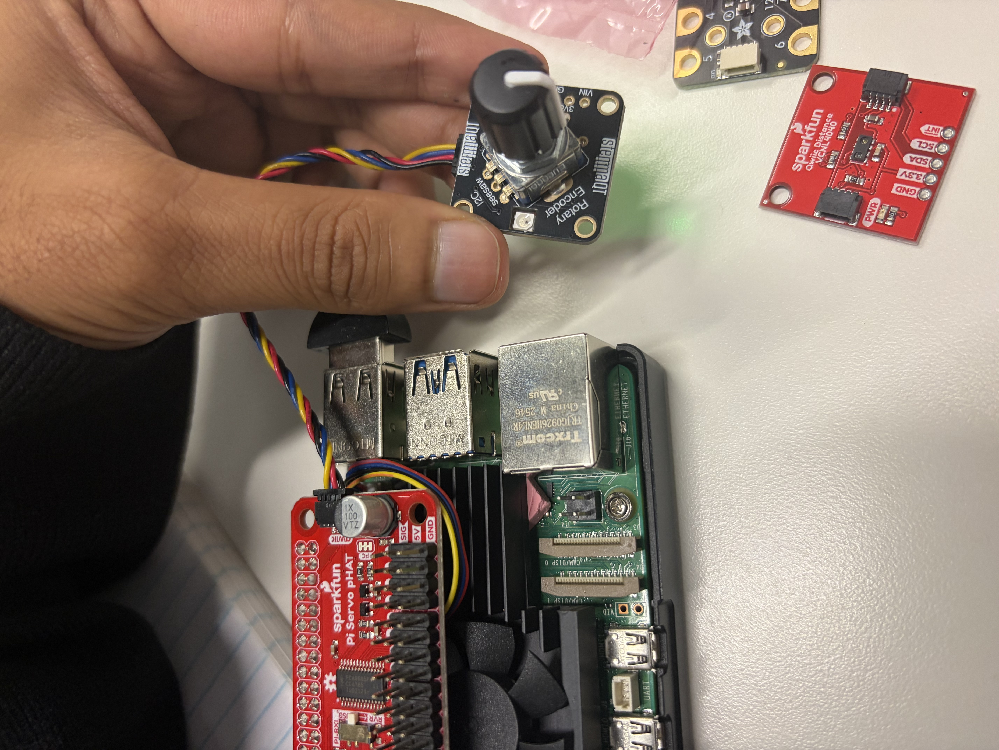 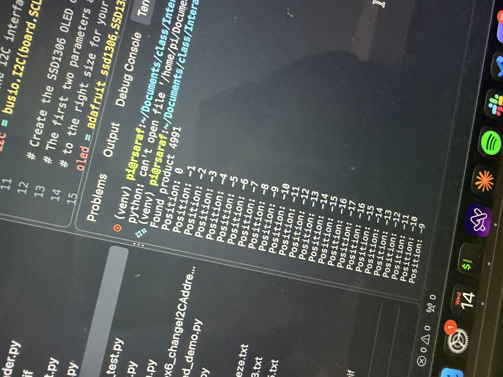

### Joystick (`0x20`)

X and Y went from **_ to _** and sat at about **_ in the middle. The button read _** when pressed.

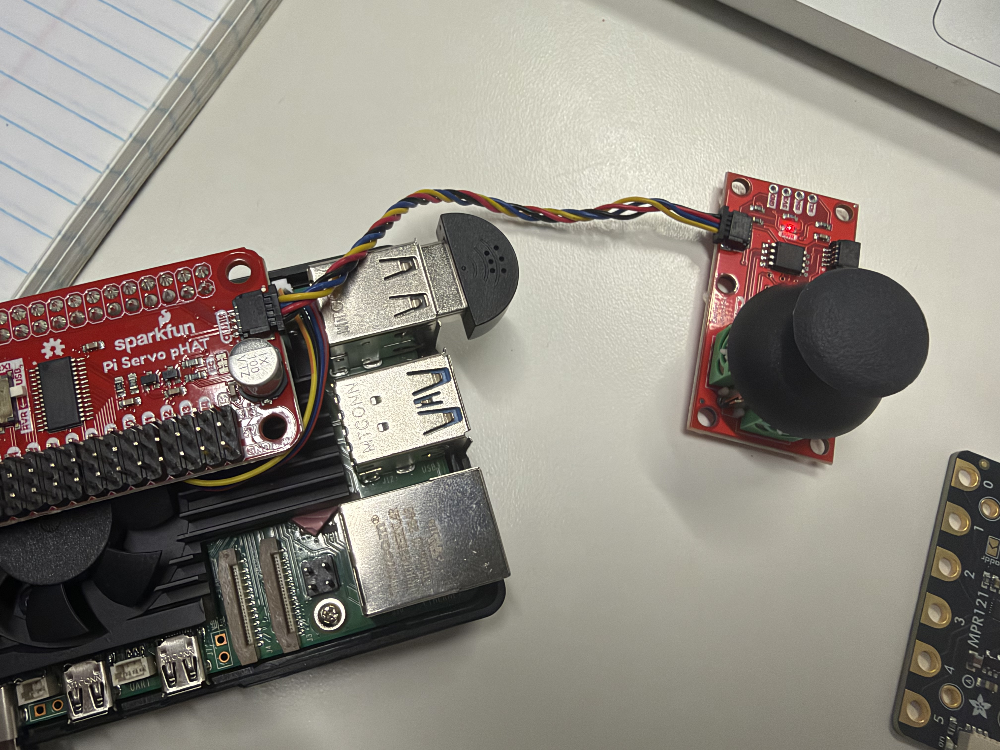 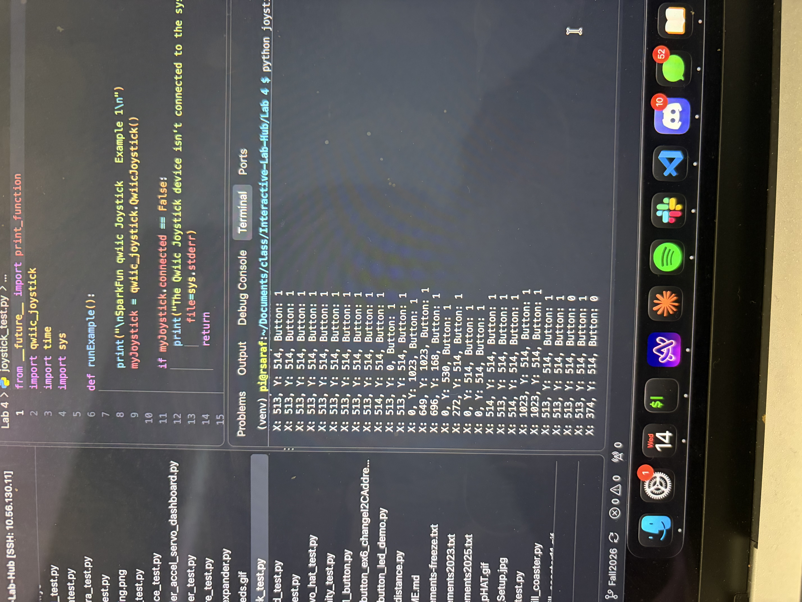

### Distance sensor (VCNL4040, `0x60`)

**_ with nothing in front, about _** with my hand at ~5 cm, **_ right up against it. It was most reliable between _** and \_\_\_ cm.

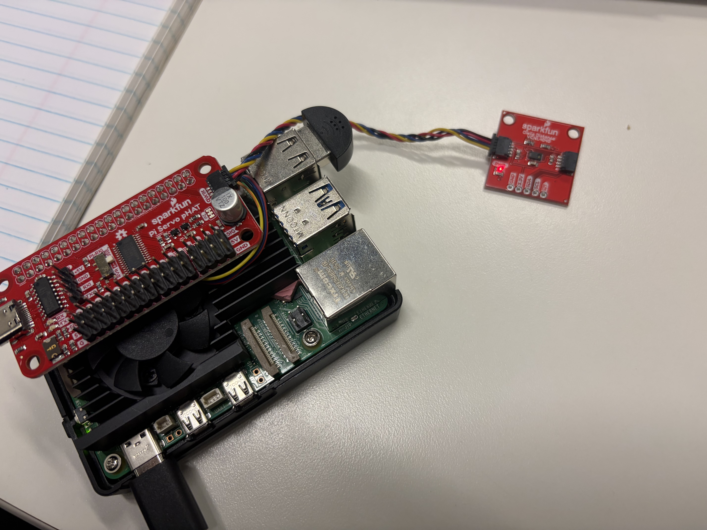 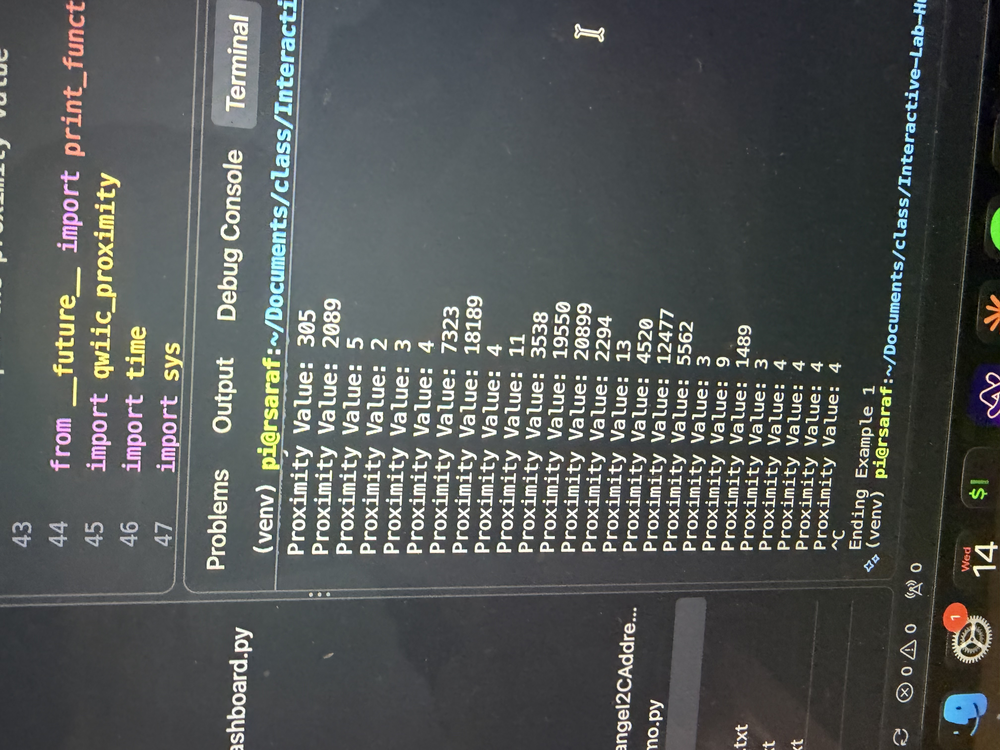

---

## Part C. Servo Actuation

I stacked the SparkFun Servo pHAT on top of the Mini PiTFT and plugged the servo into channel 0 (brown wire to GND). The Pi is powered by its own USB-C, and the pHAT has a second USB-C cable to power the servo. `i2cdetect -y 1` showed the pHAT at `0x40`. Running `pi_servo_hat_test.py` made the servo sweep back and forth.

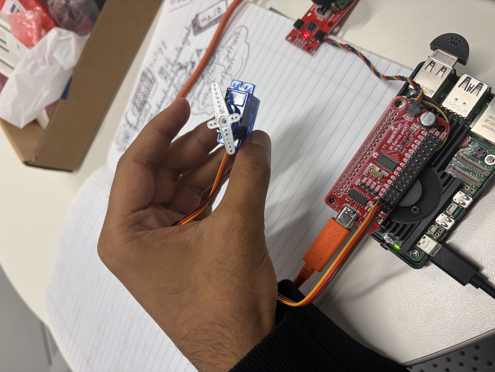

[Video of the servo sweeping](media/servo.mp4)

### Servo Control with SparkFun Servo pHAT

For this lab, you will use the **SparkFun Servo pHAT** to control a micro servo (such as the Miuzei MS18 or similar 9g servo). The Servo pHAT stacks directly on top of the Adafruit Mini PiTFT (135×240) display without pin conflicts:

- The Mini PiTFT uses SPI (GPIO22, 23, 24, 25) for display and buttons ([SPI pinout](https://pinout.xyz/pinout/spi)).
- The Servo pHAT uses I²C (GPIO2 & 3) for the PCA9685 servo driver ([I2C pinout](https://pinout.xyz/pinout/i2c)).
- Since SPI and I²C are separate buses, you can use both boards together.
  **⚡ Power:**
- Plug a USB-C cable into the Servo pHAT to provide enough current for the servos. The Pi itself should still be powered by its own USB-C supply. Do NOT power servos from the Pi’s 5V rail.

<p align="center">
    
</p>

**Basic Python Example:**
We provide a simple example script: `Lab 4/pi_servo_hat_test.py` (requires the `pi_servo_hat` Python package).
Run the example:

```
python pi_servo_hat_test.py
```

For more details and advanced usage, see the [official SparkFun Servo pHAT documentation](https://learn.sparkfun.com/tutorials/pi-servo-phat-v2-hookup-guide/all#resources-and-going-further).
A servo motor is a rotary actuator that allows for precise control of angular position. The position is set by the width of an electrical pulse (PWM). You can read [this Adafruit guide](https://learn.adafruit.com/adafruit-arduino-lesson-14-servo-motors/servo-motors) to learn more about how servos work.

---

## Part D. Physical Interaction Design: Feast Automata

### Our idea: Tea Bag Dunker

If you forget the tea bag in the cup, the tea gets way too strong. So we built a little machine that dunks the tea bag for you and takes it out when it's done.

How it works:

1. You put your mug on the marked spot. A distance sensor under the base notices the mug, and the light on the knob flashes.
2. You turn the rotary encoder to pick how strong you want the tea. The light shows the strength (light yellow = weak, dark brown = strong).
3. You press the knob to start. The servo lowers the tea bag into the mug.
4. While it steeps, the servo dunks the bag up and down every few seconds. The light slowly goes from green to orange to brown so you can see how much time is left.
5. When time is up, the arm lifts the bag out and holds it over the mug so it can drip. The light blinks.
6. If you pick up the mug in the middle, the sensor notices and the arm lifts the bag right away.

### 5 sketches

We drew 5 different ways to arrange the sensor, servo and electronics.

**Sketch 1: Crane.** A post next to the mug with the servo on top. A long arm reaches over the mug and the bag hangs from the end. The distance sensor sits in the base under the mug.

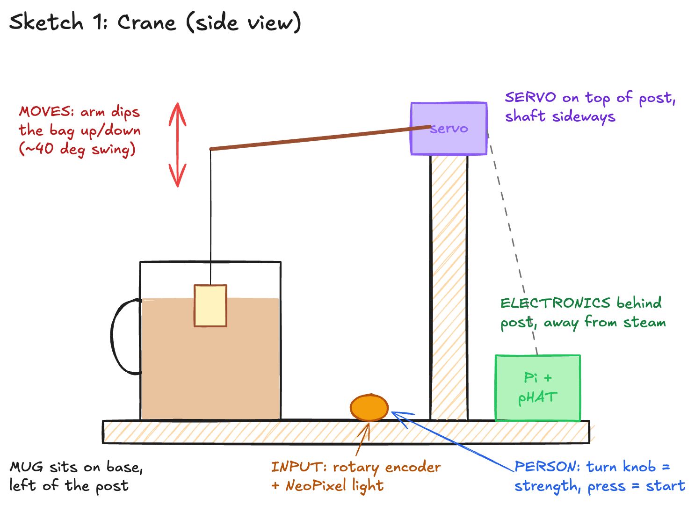

**Sketch 2: Arch.** A bridge over the mug with the servo in the middle. The bag goes straight up and down on a string the servo winds up.

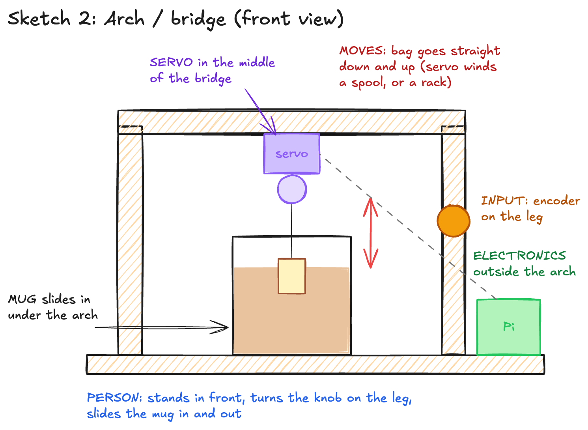

**Sketch 3: Seesaw.** A lever on a pivot. The servo pushes the short end up, so the long end with the bag goes down.

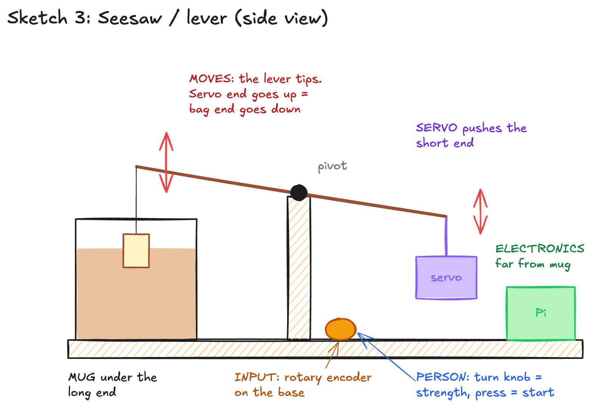

**Sketch 4: Mug clip.** A small box that clips onto the rim of any mug, with the servo and knob inside. No base needed.

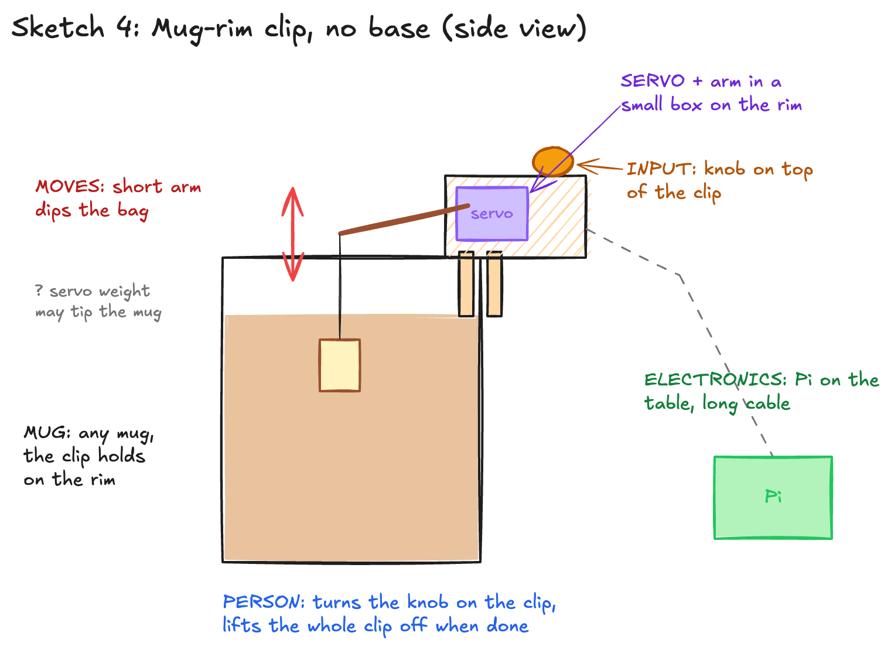

**Sketch 5: Tea butler.** A cardboard butler standing next to the mug. The servo is his shoulder, so his arm dunks the bag. The knob is a dial on his chest, and the Pi is hidden inside his body.

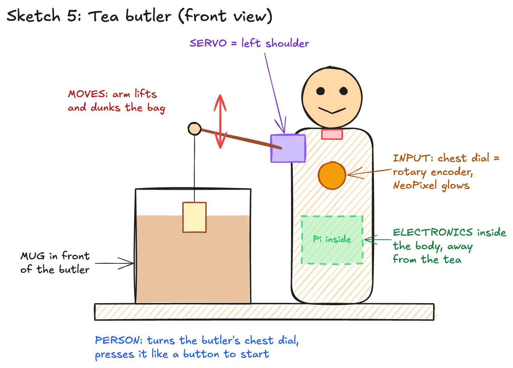

### What questions do the sketches raise?

- Can a small servo lift a wet tea bag, and does the arm swing far enough to pull it fully out of the tea?
- Where does the distance sensor need to sit to reliably tell when a mug is there? Does it work through cardboard, or does it need a hole?
- How do we keep the Pi and the boards away from the hot water and steam?
- Will the cardboard stay stiff, or bend when the arm moves or gets wet?
- Will it tip over? This is a big question for the mug clip, where everything sits on the rim.
- Can someone tell how strong the tea will be just from the color of the light?

### What do we need to prototype to answer them?

- Build the post and arm, hang a real wet tea bag from it, and move it by hand to see how high it needs to go.
- Try the distance sensor under a mug and see whether it can reliably detect it.
- Check how much steam reaches the back of the post.
- Push and shake the frame to see if it bends or tips.
- Let someone try it without explaining the light colors.

### Which design we picked and why

We picked **Sketch 1, the crane**.

- It's the simplest to build. The servo swings the arm directly, with no strings, spools or pivots.
- The distance sensor fits naturally in the base under the mug, and the knob goes on the front where people reach first.
- The Pi sits behind the post, away from the steam.
- The base is big and flat, so it won't tip over like the mug clip might.

### Rough prototype

The rough prototype is a cardboard base (about 20 × 30 cm) with a folded triangle-tube post. The servo sits in a slot near the top of the post, and a double-layer cardboard arm is glued to the servo horn. A notch at the end of the arm holds the tea bag string. The distance sensor is taped under a hole in the base where the mug goes, the knob pokes up through the front of the base, and the Pi sits behind the post.

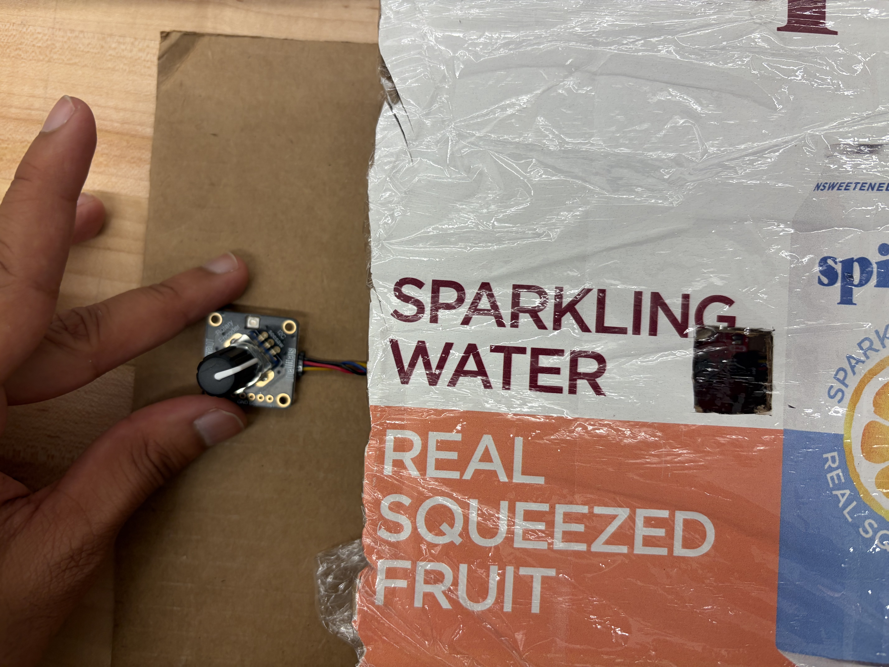 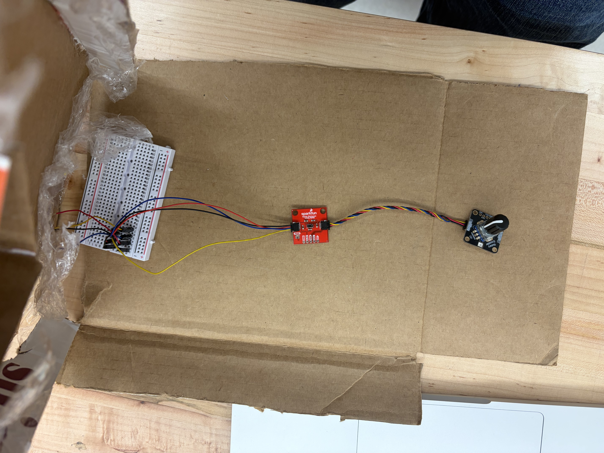

[▶ Video: rough prototype, dunking by hand](https://youtube.com/shorts/EggXWdScXNs?feature=share)

What we learned from building it:

- **Arm length:** We first cut the arm at 18 cm, but the post is only about 12 cm from the center of the mug, so we trimmed it until the notch sat right above the middle of the mug.
- **Stiffness:** We glued two layers of cardboard together for the arm and folded the post into a triangle tube so neither bends when the arm swings with a wet tea bag.
- **Sensor placement:** The distance sensor needs a hole in the base right under the mug. Through the hole it clearly sees the mug (see readings in Part E).
- **Cables:** The standard Qwiic cables were too short to reach from the Pi behind the post to the knob and the sensor at the front. We used a breadboard under the base as a hub where all the Qwiic cables meet
- **Drips:** When the mug is lifted away, the wet bag can drip onto the sensor hole. So the arm holds the bag over the mug to drip before you take it. Also cover the platform with plastic.

---

# Part 2

## Part E. Build & Integrate: Sensing + Actuation

### What we built

The Tea Bag Dunker uses **two inputs** and **two outputs**:

| | Part | What it does |
|---|---|---|
| Input | Distance sensor (VCNL4040) under the base | Detects when a mug is placed or lifted |
| Input | Rotary encoder on the front of the base | Turn to pick tea strength, press to start |
| Output | Servo on top of the post | Lowers, dunks and lifts the tea bag |
| Output | NeoPixel on the encoder | Shows strength, steeping progress, and when tea is ready |

**Code:** [`tea_dunker.py`](tea_dunker.py)

```
python tea_dunker.py         
```

| Strength | Steep time | Dunk every | Light color |
|---|---|---|---|
| Very weak | 2 min | 8 s | Light yellow |
| Weak | 3 min | 6 s | Yellow |
| Medium | 4 min | 4 s | Orange |
| Strong | 5 min | 2.5 s | Brown |
| Very strong | 6 min | 1.5 s | Dark brown |

Stronger tea also gets faster servo movement, so a strong cup looks noticeably more energetic than a weak one. The servo always moves in small 2-degree steps instead of jumping straight to an angle, so the wet bag doesn't get flung around.

### Interaction diagram

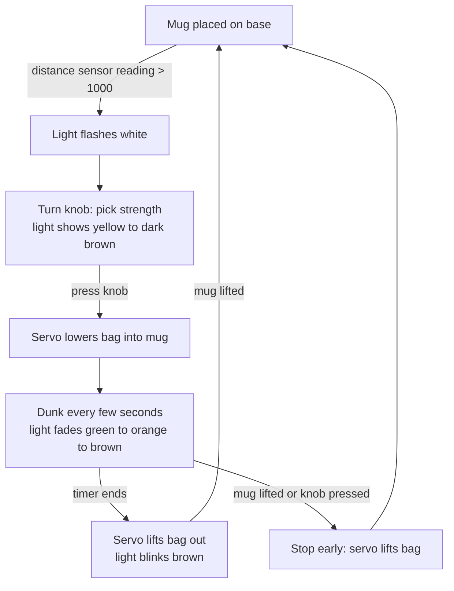

### Wiring

- The Servo pHAT sits on top of the Mini PiTFT on the Pi. The servo plugs into channel 0.
- A breadboard under the base acts as a Qwiic extender: the Pi, and the distance sensor each connect to it with a Qwiic-to-pin cable, and then the encoder connects to the distance sensor via Qwiic cable chaining.

### Working prototype

[▶ Video: full tea cycle](https://youtube.com/shorts/SZrzjsSaJDw?feature=share)

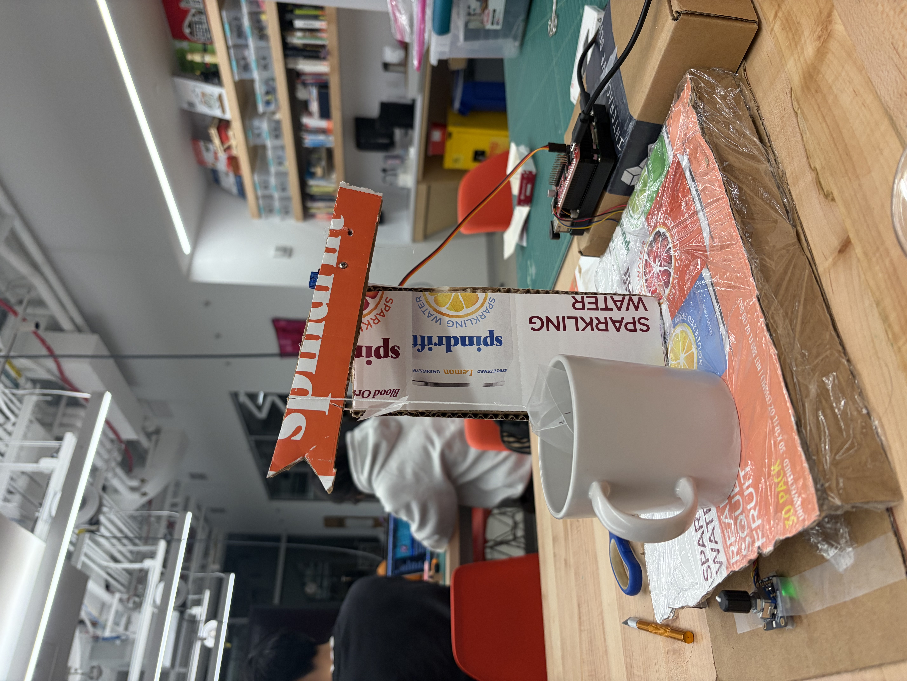 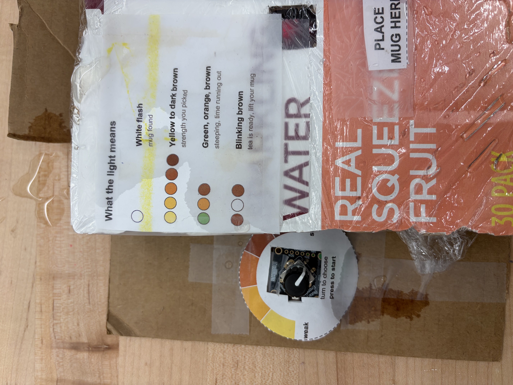

### Iterations

1. **Mug threshold.** With the sensor first taped loosely under the hole, the "no mug" reading drifted from about 860 to about 760, while a mug read about 1460. We taped the sensor down more firmly, and after that the empty reading stayed steady at about 480 to 500 while a mug read about 1400 to 1500. We set `MUG_THRESHOLD = 1000`, halfway between, so small wiggles don't trigger it.
2. **Servo angles.** We tuned the angles on the real build: `UP_ANGLE = 0` lifts the bag clear of the rim, `DOWN_ANGLE = 60` puts it in the tea. We increased each dunk (`DIP`) from 20 to 30 degrees so the bag moves enough in the water to be clearly visible.
3. **Knob direction.** At first, turning the knob right made the tea *weaker*, which felt backwards. We flipped the encoder direction so right = stronger, like turning up a volume knob.
4. **Labels.** It wasn't obvious where to put the mug or what the light colors meant, so we added printed labels: a "place mug here" circle (with a window cut out for the sensor), a weak-to-strong dial around the knob, a how-to card on the post, and a legend for the light colors.

### Reflection

**How does the sensor shape the physical response?** The distance sensor makes the mug itself the on/off switch. Because the machine only works when a mug is there, it can't dunk a bag into nothing, and lifting the mug is a natural, instant way to stop it. The knob adds a deliberate choice (how strong) on top of that automatic detection.

**How does the physical arrangement change the interaction?** Putting the sensor right under the mug spot made detection very reliable, since there's a big jump in readings. But it also meant the sensor sits right where the tea bag drips. Putting the knob at the front makes it the first thing you touch, and keeping the Pi behind the post keeps it away from steam.

**What thresholds, timing or movement make it feel clear or playful?** The threshold had to sit well between the empty and mug readings, or it would flicker on and off. Slow, gentle dunks for weak tea and fast, jerky dunks for strong tea make the strength feel physical, not just a number. The white "hello" flash when the mug is placed tells you it noticed you.

**What changes when you adjust sensor placement or servo motion?** A loosely taped sensor drifted by about 100, which was enough to make the threshold unreliable. Taping it firmly fixed it. Small changes to the servo angles made the difference between the bag clearing the rim or dragging over it.

**What was fun, surprising or challenging?** Surprising: the sensor reads about 500 even with no mug, because it sees the cardboard around the hole. Challenging: cable length. The Qwiic cables didn't reach across the base, so we had to use a breadboard as a hub. Fun: watching the light slowly fade toward brown while the bag dunks makes waiting for tea feel like something is happening.

---

## Part F. Final Documentation

### Looks like

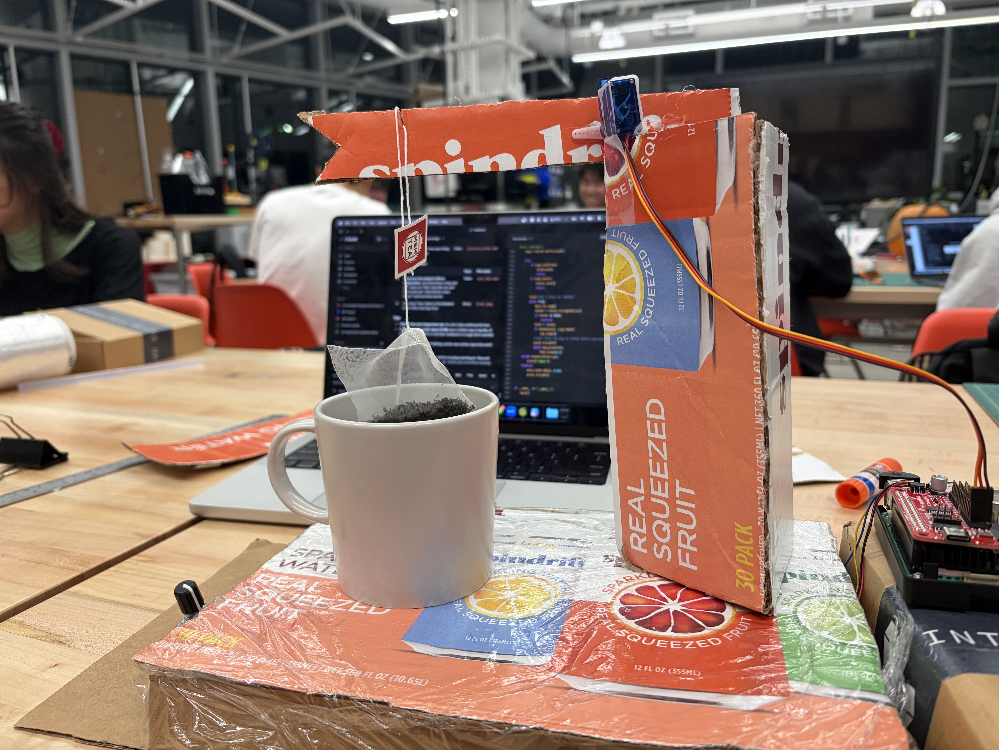 

The Tea Bag Dunker is a small cardboard crane that sits on a kitchen counter or desk next to your mug. The base is about 20 × 30 cm and the post is about 20 cm tall, roughly the size of a desk lamp. It's made of cardboard, tape and hot glue, so it's light, but the wide base keeps it from tipping when the arm moves. The mug spot is marked with a printed circle, the knob has a weak-to-strong dial around it, and a how-to card on the post explains the steps. The electronics are hidden under the base and behind the post, away from the hot water.

### Works like

[▶ Video: full tea cycle](https://youtube.com/shorts/SZrzjsSaJDw?feature=share)

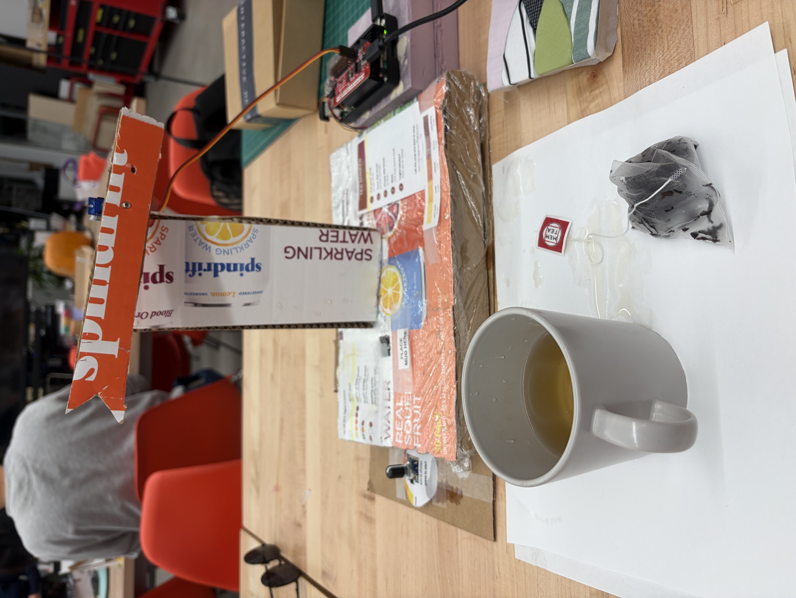

The distance sensor under the base detects the mug (reading above 1000). The rotary encoder picks one of 5 strengths (2 to 6 minutes). The Raspberry Pi runs [`tea_dunker.py`](tea_dunker.py), which tells the Servo pHAT to lower the bag, dunk it every few seconds, and lift it out when the timer ends. The NeoPixel on the encoder shows each stage: white flash = mug found, yellow to brown = strength, green to orange to brown = time left, blinking = done. Lifting the mug at any time stops it and lifts the bag.

### Acts like

[▶ Video: a participant using it](https://youtube.com/shorts/KtWW4rYMzgM?feature=share)

We gave a participant a mug and a tea bag and only said "make some tea," without explaining how it works.

- **What they understood right away:** That they had to place the cup of hotwater under the crane
- **What confused them:** how to start the brewing process, not immediately obvious that you can press the encoder button, also strength selection, even with instructions was difficuly to understand
- **What they thought the light colors meant:** Strength was perceived correctly, however, the wait time and the finish signals were confusing.
- **What we would change based on this:** Clearer instrcuctions for using the encoder, maybe a screen to help the user with every step or a speaker. Also a color sensor for automatic strength detection. Also a mechanism for adding/removing the tea bag or a signal for that