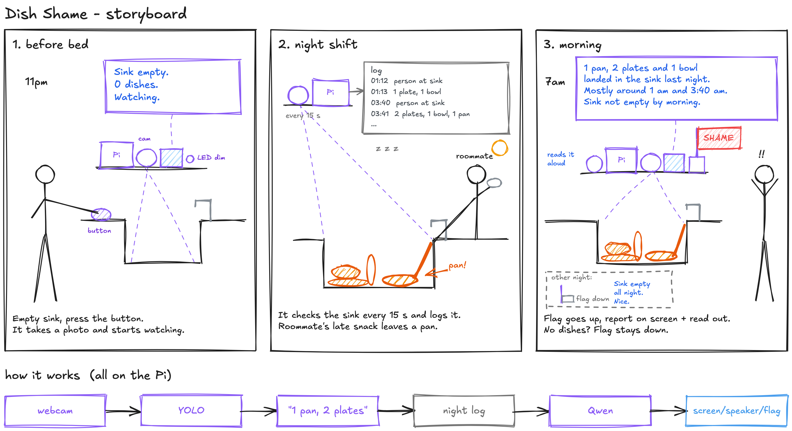
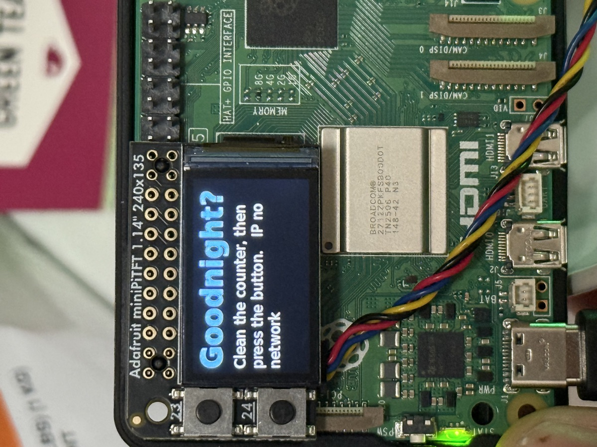
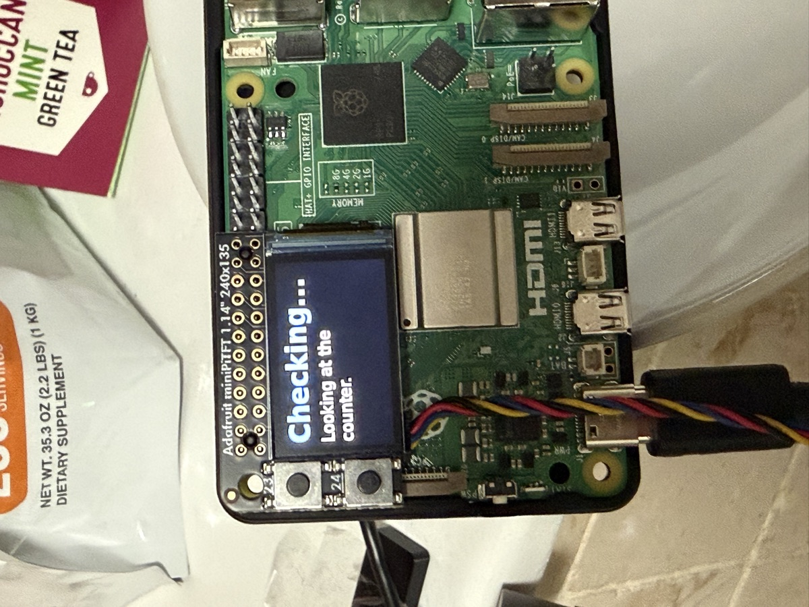
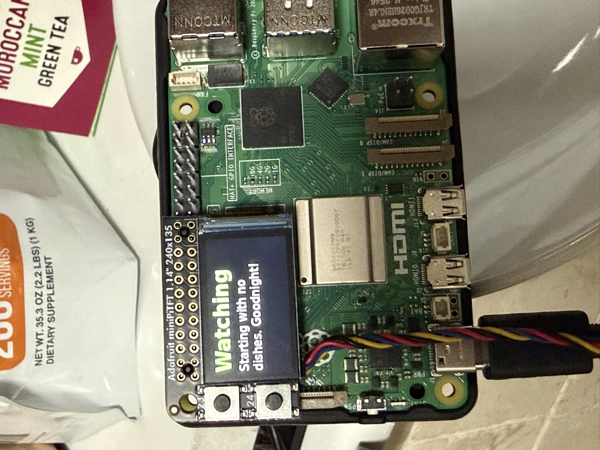
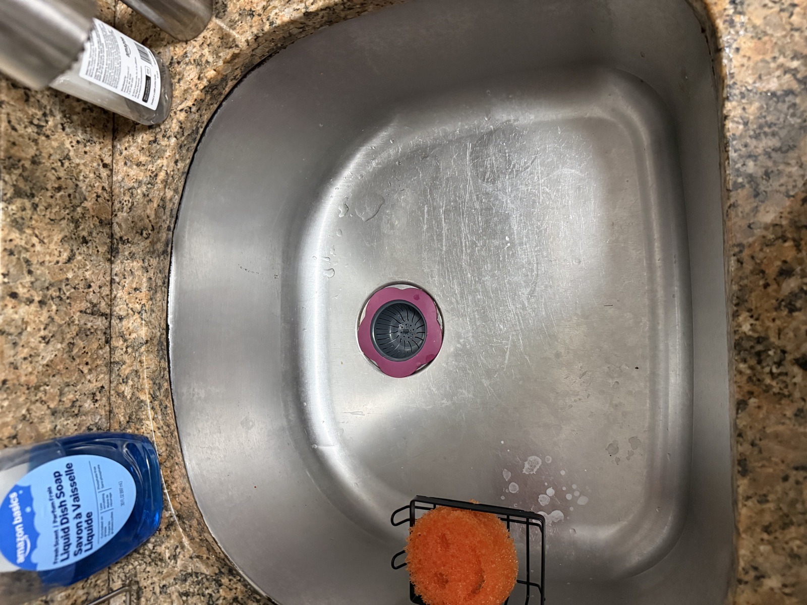
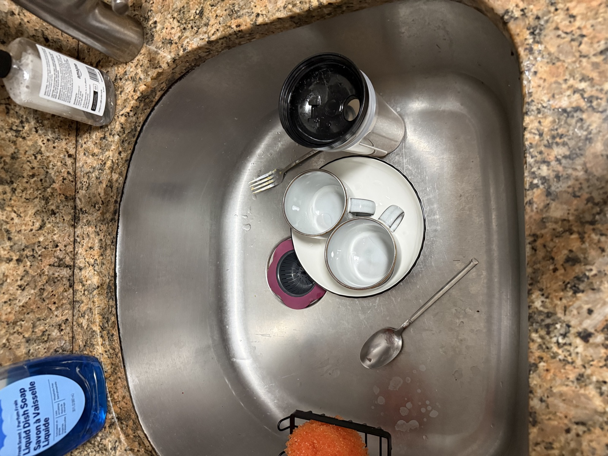
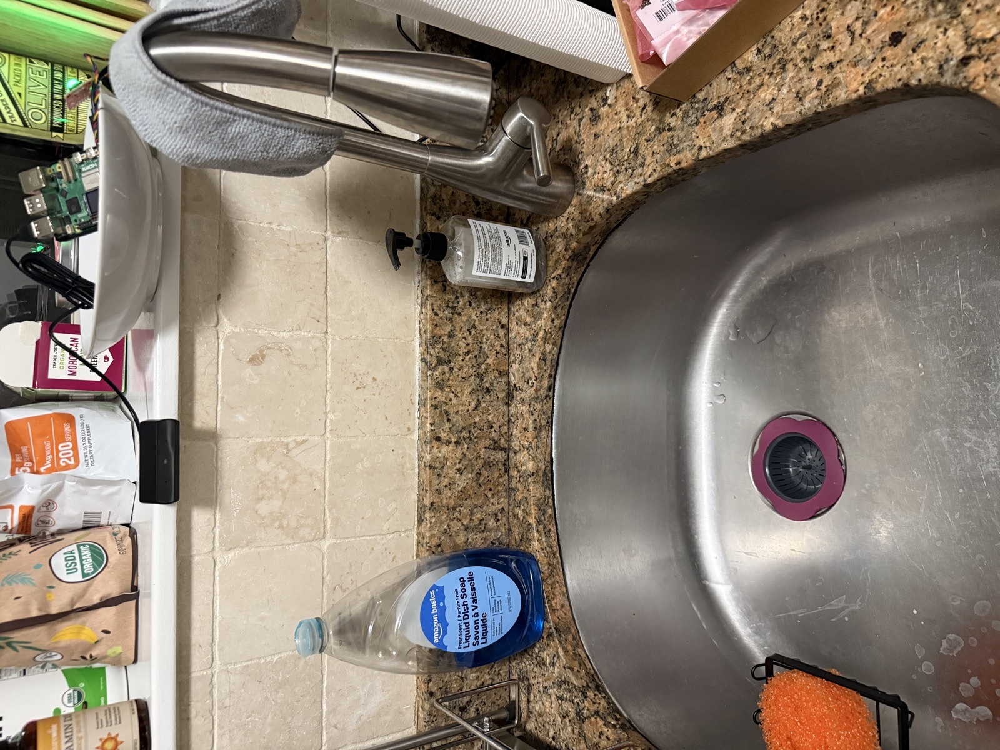
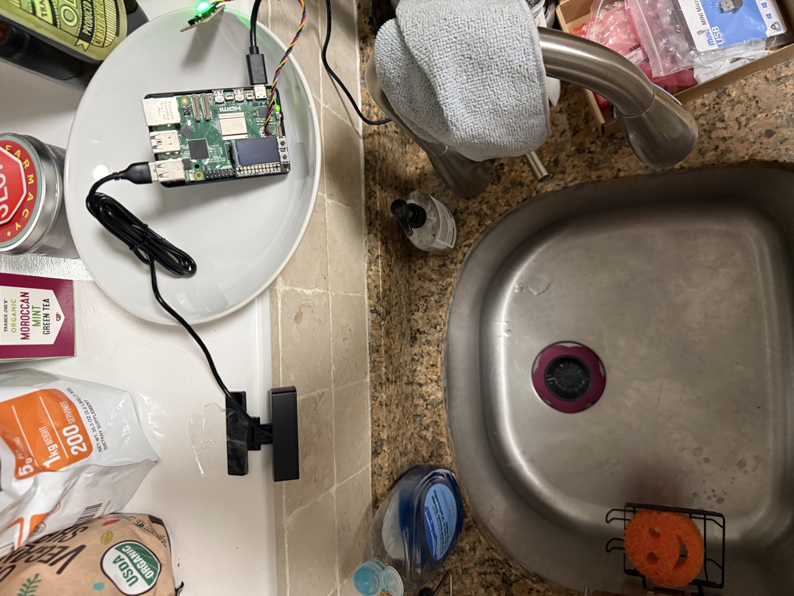
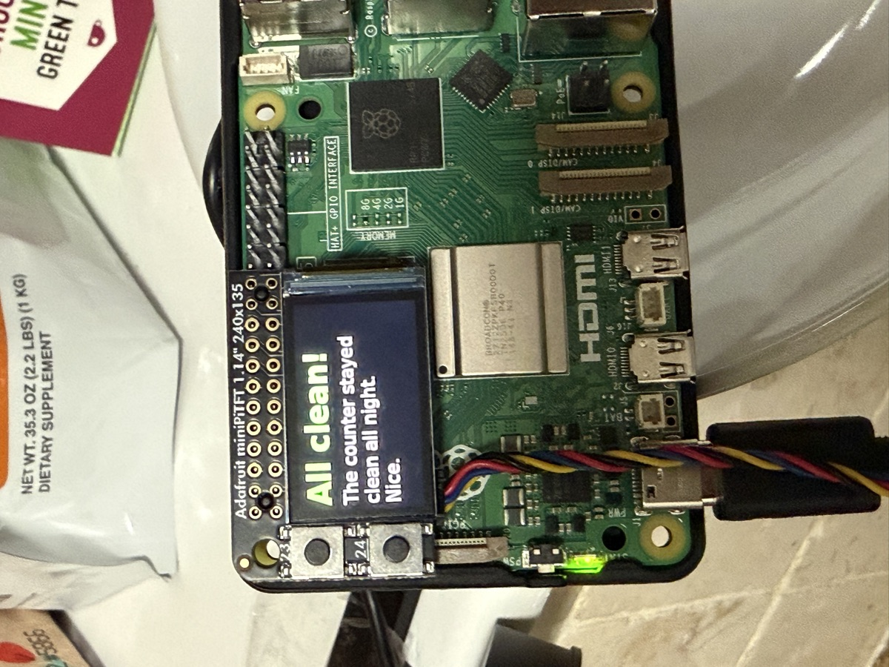

# Observant Systems: Overnight Sensation

**Team:** Andreas Kilbinger and Rohil Saraf  
**Members:** Andreas Kilbinger (awk84, andikilbinger), [Rohil Saraf](https://github.com/rohilsaraf97) (rs2685, rohilsaraf97)  
**Project name:** Dish Shame

**Who did what:** I (Andreas) built the Dish Shame code, set up the Pi and ran the overnight test at home. <!-- TODO: add what Rohil did -->

**Collaboration and help:** The starter code (`yolo_to_qwen.py`, `overnight.py`, `morning.py` and the other Part 1 scripts) is from the class repo. I used Claude (an AI assistant) to help me write the Dish Shame code (`dish_*.py`, `setup_pi.sh`, `start_night.sh`, `install_service.sh`), to debug the Pi setup, and to help write up this README. The screen code is based on Lab 2's `screen_clock.py`, the button on Lab 4's `qwiic_1_button.py`, and the voice on Piper from Lab 3.

---

# Part 1

## Part A. Set up your Pi for on-device AI

I installed everything with one script ([setup_pi.sh](setup_pi.sh)): the Python environment, the YOLO26 nano model (exported to NCNN), Ollama with the two Qwen models, and a Piper voice for Part 2. Before that I tried everything on my Mac first. YOLO found 4 people and 1 bus in the test picture.

<!-- TODO (Claude): paste `ollama list` output from the Pi -->


## Part B. See: recognize people in real time with YOLO

<!-- TODO (you): screenshot or short video of yolo_person.py through VNC -> media/yolo_person.png -->


Three situations where it did not see me, or saw someone who wasn't there:

1. <!-- TODO (you): e.g. lights off: ... -->
2. <!-- TODO (you): e.g. back turned / only half in the frame: ... -->
3. <!-- TODO (you): e.g. photo of a person on my phone: ... -->

## Part C. See more: hands and pose with MediaPipe

<!-- TODO (you): screenshot or short video of hand_pose.py through VNC -> media/hand_pose.png -->


How I could use pose tracking in my system: for Dish Shame, hand tracking could tell the difference between someone *putting a cup down* and someone just walking past the counter. A hand that opens right above the counter and a new cup showing up at the same spot is a much stronger sign than "a cup appeared". I could also use the "Quiet Coyote" gesture as the bedtime hand-off instead of the button.

## Part D. Reason: run Qwen on the Pi with Ollama

<!-- TODO (Claude): 3 questions on the Pi with answers + times, one compared with qwen3:0.6b -->

| # | Question | Model | Time | Answer |
|---|---|---|---|---|
| 1 | Tell me a bit about the history of Roosevelt Island. | qwen3.5:0.8b | | |
| 2 | | qwen3.5:0.8b | | |
| 3 | | qwen3.5:0.8b | | |
| 1 | (same as 1) | qwen3:0.6b | | |

When I first tried the Roosevelt Island question on my laptop, Qwen made almost everything up. It said the island was built for a "Governor George A. Devereaux" in 1904 and became an apartment complex with 60 people. None of that is true. It was Blackwell's Island, then Welfare Island, it got its name in 1973 and Cornell Tech opened there in 2017. It sounded very sure of itself anyway. This changed how I built Part 2 (see Part I).

## Part E. Connect: from YOLO readings to Qwen reasoning

<!-- TODO (Claude): run yolo_to_qwen.py --headless on the Pi, paste the log + Qwen's answer -->

```
(log + answer goes here)
```

---

# Part 2: Dish Shame

## Part F. Storyboard

**The idea:** a little device that watches the kitchen sink overnight. At bedtime you press a button to say "the sink is empty now". During the night it counts the dishes that show up. In the morning it tells you what appeared and when, and if dishes were left, it shames you (red screen, "SHAME +3"). It only counts things. It never says who did it. (In the code and on the screen it says "counter", because it works the same for a counter.)



Before bed / while asleep / when awake:
1. **Before bed:** empty the sink, press the button. It checks the sink and says goodnight.
2. **While asleep:** every 15 seconds it looks at the sink and counts cups, bowls, glasses, bottles and cutlery. It writes down every change.
3. **When awake:** press the button. The screen shows the report and a speaker reads it out loud.

### Feedback

<!-- TODO (you): feedback you got on the storyboard -->

### The five questions (Bellotti et al.)

- **Address** (how do I tell it that I mean it?): the button. One press at bedtime, one in the morning.
- **Attention** (how do I know it's listening?): the button light is bright when it waits, dim when it's watching at night. Every minute the screen shows a quick photo of what it sees.
- **Action** (what does it do?): it only counts dishes and logs changes. Nothing else.
- **Alignment** (does it do what I wanted?): the bedtime check tells you right away if it already sees dishes ("Not clean! I see 1 cup").
- **Accident** (how do I fix mistakes?): press the button again at bedtime to re-check. In the morning the facts come from the log, not from the language model, so it can't make up dishes.

## Part G. The interaction before bed

The whole thing is one button. When the Pi is on, the screen says **"Goodnight? Clean the counter, then press the button."** (with the IP at the bottom so I can still find the Pi).

When you press it, it takes 5 photos and counts the dishes. If the counter isn't clean it says so ("Not clean! I see 2 cups") and you can clean up and press again, or wait 20 seconds and it starts anyway. Then it says "Goodnight. I'm keeping an eye on the counter.", the button light goes dim and the screen turns off. That's the hand-off, about 30 seconds.

What the screen showed at bedtime, in order:

| 1. Waiting | 2. After pressing | 3. Night starts |
|---|---|---|
|  |  |  |

The first screen says "IP no network". At home the Pi has no Wi-Fi, which is fine because everything runs offline. But I noticed the IP only gets checked once when the program starts, so on campus it could also say "no network" if the Wi-Fi connects a few seconds later. I changed it so the IP on that screen updates every few seconds.

## Part H. The observant system at night

How it works ([dish_shame.py](dish_shame.py)):
- **Detector:** every 15 seconds the webcam takes 3 photos and YOLO looks at them ([dish_detect.py](dish_detect.py)).
- **Interpreter:** it only keeps cups, bowls, wine glasses, bottles, forks, knives, spoons, and whether a person is at the counter. It takes the middle value of the 3 photos, so one bad frame doesn't add a fake cup.
- **Log:** a line only goes into the night log when something changes, plus an "I'm alive" line every 10 minutes.
- **Proof on the screen:** when the dishes change, the screen lights up for 10 seconds with the photo YOLO just looked at, with boxes around the dishes and a caption like "01:13 +1 cup (1 dish)". Every minute it also shows a quick 5-second "check" photo, so I could see it was still working.

Everything runs on the Pi with no internet. It starts by itself when the Pi turns on (a systemd service), so I could just plug it in at home.

<!-- TODO (Claude): real night log + numbers from tonight -->

```
(night log goes here)
```

<!-- TODO (Claude): proof photos from snaps/ -> night/ -->

What the sink looks like empty (what I want at bedtime) and with dishes in it (what I want it to catch):

| Empty | With dishes |
|---|---|
|  |  |

The setup at home: the Pi sits in a bowl on the shelf above the sink (away from the water), and the webcam is clipped to the edge of the shelf, looking down into the sink.

| From the front | From above |
|---|---|
|  |  |

## Part I. The interaction when awake

Press the button again in the morning. The screen says "Good morning", then shows either **"SHAME +3"** in red or **"All clean!"** in green, and the speaker reads the report out loud ([dish_report.py](dish_report.py)).

**What I learned about Qwen:** my first version let Qwen write the whole report from the log. In a test it said "no one was at the counter" when the log clearly had a person, and it made up "you two". So now:
- **Python writes the facts sentence**, e.g. "3 cups, 1 bowl showed up on the counter overnight, mostly around 1 am." That way the numbers are always right.
- **Qwen only adds one short joke** on top. If the joke has any numbers, times or names in it, I throw it away and just use the facts. In my tests about 1 in 3 jokes broke this rule (for example "three cups" or "midnight").
- **If nothing happened, Qwen isn't asked at all.** It just says "The counter stayed clean all night. Nice." That way it's honest about a quiet night.

<!-- TODO (Claude): the real morning report from tonight -->

The screen the next morning:



<!-- TODO (Claude + you): say whether the sink really was clean, or whether it missed dishes (check the night log) -->

### What worked and what didn't

<!-- TODO (Claude + you): fill in after looking at the night log -->
- 
- One problem: the Pi has no clock battery. When I unplugged it to take it home there was no internet, so the Pi started with the time from when I unplugged it. The dish counts are right, but the times in the report are off by however long it was unplugged.

---

## Final documentation

<!-- TODO (you): short video of the whole system -> link here (YouTube/Drive if it's big) -->

**Video:** 

- **Looks like:** the Pi with its little screen in a bowl on the shelf above the sink, the webcam clipped to the shelf edge looking down, and the button next to it. At night the screen is dark and only flashes a photo once a minute.
- **Works like:** webcam → YOLO → interpreter (dish counts) → night log → Python facts + Qwen joke → screen + voice.
- **Acts like:** press at bedtime, forget about it, press in the morning and get shamed (or praised).

### Code

| File | What it does |
|---|---|
| [dish_shame.py](dish_shame.py) | the whole night: bedtime, watching, morning |
| [dish_detect.py](dish_detect.py) | YOLO + counting the dishes |
| [dish_report.py](dish_report.py) | the morning report (Python facts + Qwen joke) |
| [dish_hw.py](dish_hw.py) | screen, button, servo flag, voice |
| [setup_pi.sh](setup_pi.sh) | installs everything on the Pi |
| [install_service.sh](install_service.sh) | makes it start when the Pi turns on |
