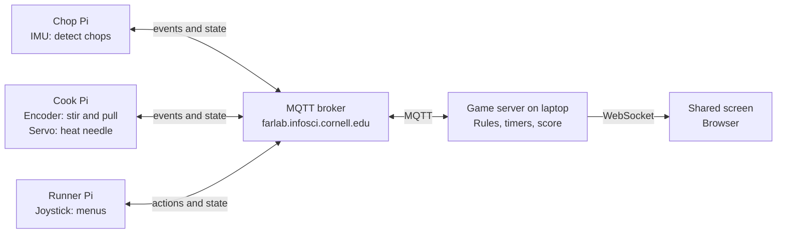

# Order Up! — Lab 6 Game Plan

A co-op kitchen game for three players and three Raspberry Pis. Orders appear on a shared screen, and the team has to prep and serve them before time runs out.

**Status:** proposal for the team to review. Nothing here is built yet. Numbers such as timers and scores are starting guesses to tune in playtesting.

"Order Up!" is a working title. The idea comes from co-op kitchen games we like, but the name, art, recipes and rules are our own.

---

## The game in 30 seconds

1. **Everyone watches the shared screen**, which shows order tickets counting down, the counter and both stations.
2. **The Runner** uses a joystick to get ingredients, send them to stations, throw things out and serve orders. Only the Runner can move food.
3. **The Chopper** physically chops with a sensor-packed knife.
4. **The Cook** physically stirs a pan, then pulls the food off before it burns.
5. **The team shouts at each other** and scores as many points as possible in a 3-minute round.

The fun comes from the split: the Runner can move food but can't prepare it, and the Chopper and Cook can prepare it but can't move it.

---

## Physical setup

```text
                 ┌─────────────────────────┐
                 │       SHARED SCREEN     │
                 │  (laptop or big monitor)│
                 └─────────────────────────┘

   ┌─────────┐        ┌─────────┐        ┌─────────┐
   │ CHOP Pi │        │RUNNER Pi│        │ COOK Pi │
   │  knife  │        │ joystick│        │ pan+knob│
   └─────────┘        └─────────┘        └─────────┘
```

The stations sit in a row facing the screen, close enough for the team to talk.

| Station | Input | Output | Parts |
|---|---|---|---|
| **Chop Pi** | Chop motions | Item and chop progress on the Pi's screen | LSM6DS3 IMU in a cardboard knife, on a Qwiic cable |
| **Cook Pi** | Encoder turn = stir, encoder press = take off heat | Servo needle (cold → done → burning), encoder LED, Pi screen | Rotary encoder in a cardboard pan, Servo pHAT, servo |
| **Runner Pi** | Joystick flick and press | Menu on the Pi's screen | Qwiic joystick |
| **Shared screen** | None | Tickets, counter, stations, score, timer | Laptop browser, plus a monitor or projector if available |

Every Pi also uses its Mini PiTFT and Qwiic SHIM. The Servo pHAT needs **its own USB-C power**, as covered in Lab 4.

---

## Rules

### Recipes

| Order | Needs | Prep path | Points |
|---|---|---|---|
| **Salad** | Chopped lettuce + chopped tomato | Chop, chop | 10 |
| **Burger** | Bun + cooked patty + chopped lettuce | Cook, chop | 20 |
| **Tomato soup** | Soup | Chop tomato, then cook it | 20 |

### Ingredients and stations

| Starting item | At Chop | At Cook |
|---|---|---|
| Lettuce | Chopped lettuce | Ruined |
| Tomato | Chopped tomato | Ruined |
| Chopped tomato | Ruined | Soup |
| Patty | Ruined | Cooked patty |
| Bun | Ruined | Ruined |

Bun needs no prep. Ruined and burnt food can't be served and takes up a counter slot until someone throws it out.

### The counter

- The counter has **6 slots**, shown on the shared screen.
- New ingredients and finished food all land here.
- A full counter blocks the Runner from getting more food, and a finished item waits at its station until a slot opens.
- This limit is what makes throwing things out matter.

### Stations

Each station holds one item at a time. Sending to a busy station is rejected.

- **Chop:** 6 clear chops finish the item, and it returns to the counter automatically.
- **Cook:** stirring fills the progress meter, and progress stops when stirring stops.
  - When the item is done, the Cook has **8 seconds** to press the encoder and move it to the counter.
  - After that, it burns.

### Orders and scoring

- Up to 4 tickets show at once, and a new one arrives about every 20 seconds.
- Each ticket lasts about 60 seconds.
- A served order earns its points, plus a tip for time remaining.
- An expired ticket costs 10 points.
- A round lasts 3 minutes.

---

## Runner controls

There are four actions, one per joystick direction:

```text
             ↑  GET
             │
 ← TRASH ────●──── SEND →
             │
             ↓  SERVE
```

| Action | Step 1 | Step 2 | Result |
|---|---|---|---|
| **Get** | Flick up/down to pick an ingredient, press to confirm | | Item lands on the counter |
| **Send** | Pick a counter item, press | Flick left for Chop or right for Cook | Item moves to that station |
| **Trash** | Pick a counter item, press | | Item is removed |
| **Serve** | Pick a ticket, press | | The server takes the needed items from the counter and scores the order. If something's missing, the screen says what, and nothing is removed |

Flicking left inside a list goes back, except in Send's station choice, where left means Chop and the Pi's top button goes back. Menu movement stays on the Pi so it feels instant, and only the confirmed action goes over the network.

---

## Shared screen layout

```text
┌──────────────────────────────────────────────────────────┐
│  SCORE 140                                   TIME 1:42   │
├──────────────────────────────────────────────────────────┤
│  ORDERS                                                  │
│  [Burger  ████░░ 38s]  [Salad  ██░░░░ 14s]  [Soup  52s]  │
├──────────────────────────────────────────────────────────┤
│  COUNTER                                                 │
│  [bun] [chopped lettuce] [BURNT] [ ] [ ] [ ]             │
├───────────────────────────┬──────────────────────────────┤
│  CHOP: tomato  ●●●●○○     │  COOK: patty  ███░  stir!    │
├───────────────────────────┴──────────────────────────────┤
│  Runner: "Missing cooked patty"                          │
└──────────────────────────────────────────────────────────┘
```

It has to be readable from across the room, so it needs big text, strong colors and urgent animation on tickets that are about to expire.

---

## Architecture

One **game server on a laptop** holds all game state and applies the rules. The Pis sense actions and display what the server tells them.



**Why one server:** a single source of truth means the Pis can't disagree about what's on the counter, and a Pi that restarts can catch up by reading the latest state.

**Where computation happens** (the lab's reflection asks about this):

| Where | What | Why |
|---|---|---|
| Pis | Turning raw sensor data into chops, stirs and menu choices | Needs fast sampling, and sending raw IMU data over the network would be wasteful |
| Laptop | Rules, timers, score | Needs one authority |
| Browser | Drawing the screen | Keeps display code separate from game logic |

The language model isn't needed for this game. A stretch idea is a head-chef line between rounds.

---

## MQTT topics

Everything lives under `IDD/orderup/`, so we stay within the team topic space the lab asks for. Broker settings are in the Lab 6 README.

### Pi to server

| Topic | Example payload | QoS | Notes |
|---|---|---|---|
| `IDD/orderup/chop/event` | `{"type":"chop"}` | 0 | One message per detected chop |
| `IDD/orderup/cook/event` | `{"type":"stir","ticks":3}` | 0 | Send at most about 5 per second, with ticks added up |
| `IDD/orderup/cook/event` | `{"type":"pull","id":"k12"}` | 1 | `id` prevents double-handling |
| `IDD/orderup/runner/action` | `{"action":"get","item":"tomato","id":"r7"}` | 1 | |
| `IDD/orderup/runner/action` | `{"action":"send","slot":2,"to":"chop","id":"r8"}` | 1 | |
| `IDD/orderup/runner/action` | `{"action":"trash","slot":3,"id":"r9"}` | 1 | |
| `IDD/orderup/runner/action` | `{"action":"serve","ticket":41,"id":"r10"}` | 1 | |
| `IDD/orderup/<station>/online` | `1` or `0` | 1 | Retained, with a last-will message of `0` so the screen can show a dropped Pi |

### Server to Pis

| Topic | Example payload | QoS | Notes |
|---|---|---|---|
| `IDD/orderup/state` | Full game state as JSON | 1 | Retained. Publish on change, at most 5 per second |
| `IDD/orderup/runner/result` | `{"id":"r10","ok":false,"msg":"Missing cooked patty"}` | 1 | Response to a Runner action |

### State example

```json
{
  "phase": "playing",
  "time_left": 102,
  "score": 140,
  "tickets": [{"id": 41, "recipe": "burger", "time_left": 38}],
  "counter": ["bun", "chopped_lettuce", "burnt", null, null, null],
  "chop": {"item": "tomato", "progress": 4, "needed": 6},
  "cook": {"item": "patty", "progress": 0.75, "status": "cooking", "burn_in": null}
}
```

`phase` is one of `lobby`, `playing` or `over`. `cook.status` is one of `empty`, `cooking`, `done` or `burning`.

---

## Proposed code layout

```text
Lab 6/order-up/
├── server/
│   ├── game.py            # Rules only, no network code, so it's easy to test
│   ├── app.py             # Flask, Socket.IO and MQTT glue
│   └── templates/
│       └── screen.html    # Shared screen
├── pi/
│   ├── common.py          # Broker settings and helpers
│   ├── chop_station.py
│   ├── cook_station.py
│   └── runner_station.py
├── sim/
│   └── sim_station.py     # Keyboard stand-in for any Pi
└── tests/
    └── test_game.py
```

**Reusable code:**

| Need | Start from |
|---|---|
| Flask and Socket.IO server | `Lab 6/app.py` |
| MQTT bridge | `Lab 6/mqtt_bridge.py` |
| Publishing from a Pi and drawing on its screen | `Lab 6/pixel_grid_publisher.py` |
| Joystick | `Lab 4/joystick_test.py`, `Lab 4/dessert_box.py` |
| Encoder and encoder button | `Lab 4/encoder_test.py` |
| IMU and servo | `Lab 4/encoder_accel_servo_dashboard.py`, `Lab 4/pi_servo_hat_test.py` |

**Setup notes:**

- `Lab 6/requirements-pi.txt` doesn't include the libraries for our sensors. We'll also need `sparkfun-qwiic-joystick`, `adafruit-circuitpython-seesaw`, `adafruit-circuitpython-lsm6ds` and `sparkfun-pi-servo-hat`.
- Run `sudo systemctl stop piscreen.service` before using a Pi's screen.
- Use the `threading` Socket.IO mode at first. `app.py` prefers eventlet, which adds complexity we don't need.

---

## Build order

Each milestone produces something we can run. The simulator lets the game be built and tested on a laptop without any Pi hardware.

| # | Milestone | Done when | Owner |
|---|---|---|---|
| 1 | **Parts check** | Each Pi's parts show up in `i2cdetect -y 1` and run their Lab 4 example | TBD |
| 2 | **Network check** | Three Pis and the laptop exchange messages, and we've measured the round-trip time | TBD |
| 3 | **Game rules** | `game.py` and its tests cover recipes, the counter, burning and scoring | TBD |
| 4 | **Shared screen** | A full round is playable from the simulator on one laptop | TBD |
| 5 | **Chop station** | Real chops count reliably, and non-chop movement mostly doesn't | TBD |
| 6 | **Cook station** | Stirring, pulling and the servo needle all work | TBD |
| 7 | **Runner station** | All four actions work with the joystick | TBD |
| 8 | **Team playtest** | Three of us finish a round, and we tune the numbers | TBD |
| 9 | **Props** | Knife and pan are sturdy enough for strangers to use | TBD |
| 10 | **User test** | 2+ people outside the team have played, with photos or video | TBD |
| 11 | **Documentation** | Lab 6 README is replaced with our writeup | TBD |

Milestones 3–4 and 5–7 can run in parallel, so one person can own the server and screen while the others take stations.

---

## Risks

| Risk | Plan |
|---|---|
| Campus Wi-Fi or the broker is slow or down on demo day | Make the broker address a setting, so we can run our own Mosquitto broker on the laptop |
| Other teams share the broker login | Keep everything under our topic prefix. No game data is secret, so this is low risk |
| Chop detection misfires | Use a spike threshold plus a short lockout between chops, and tune it with real swings |
| Qwiic cables pull out or are too short for a good swing | Secure the Pi to the table, add strain relief at the knife and test with outside players' force |
| Runner menus are too slow | Time it in the first playtest, then cut steps. For example, Serve could pick the oldest ready order automatically |
| Chopper or Cook has nothing to do | Tune arrival rates and recipes so stations stay busy, and add recipes if needed |
| Hardware fails during the demo | The simulator can stand in for any station |

---

## How this maps to the lab

| Requirement | How we meet it |
|---|---|
| 3+ people, 3+ Pis | Three roles, one Pi each |
| Each Pi sends sensor input over MQTT | IMU, encoder and joystick events |
| Meaningful or fun interaction | A co-op game that depends on all three players |
| Project description, diagram, build docs | This plan is the starting point |
| User testing with 2+ outsiders | Milestone 10. Record their expectations, surprises and suggested changes |
| Reflection, including where computation happens | See [Architecture](#architecture) |

---

## Decisions for the team

1. **Roles and owners:** who takes which milestones in the table above?
2. **Hardware:** which Pi gets which parts? Do we have a working joystick, and a spare USB-C supply for the Servo pHAT?
3. **Screen:** whose laptop runs the server, and can we get a monitor or projector for testing?
4. **Name and theme:** keep "Order Up!" and a diner theme, or make it stranger?
5. **Topic prefix:** is `IDD/orderup/` fine?
6. **Schedule:** add the due date and work back from it.
