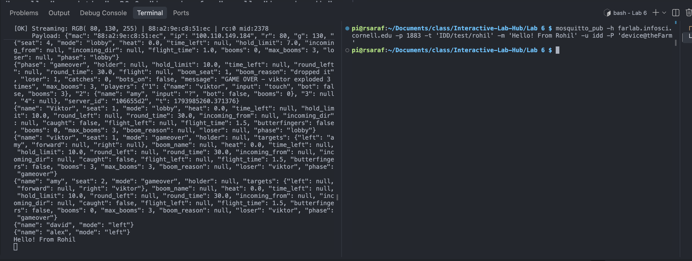
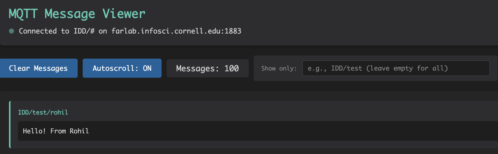
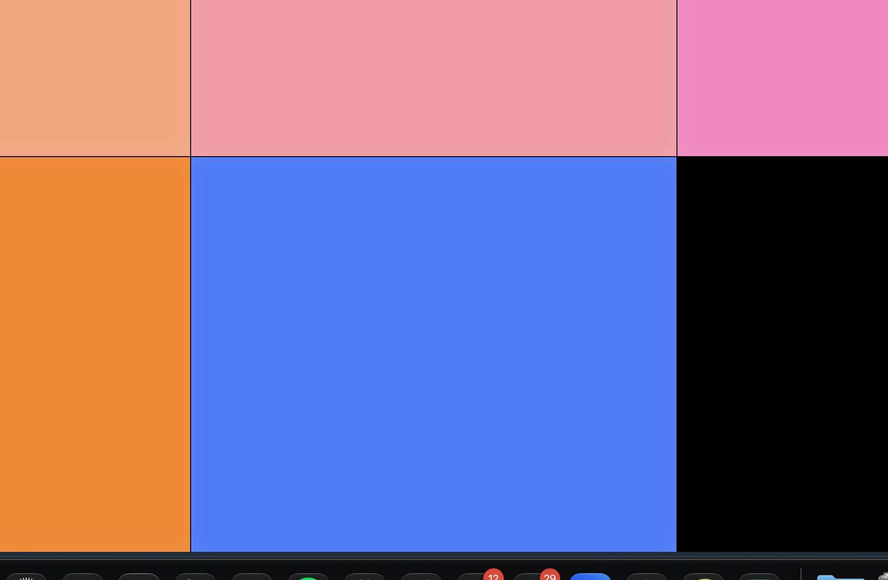
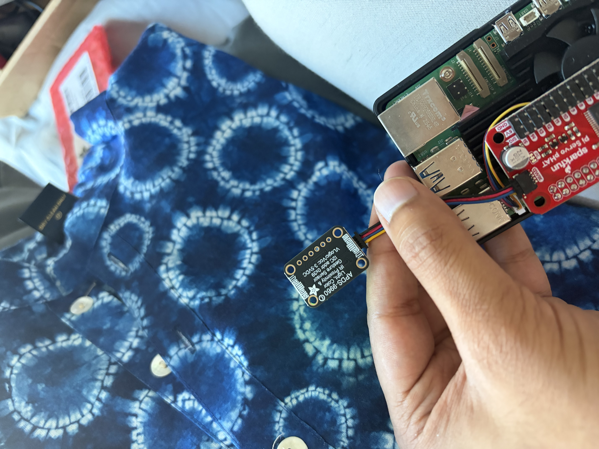

# Distributed Interaction

**Team:** Rohil Saraf, [TEAMMATE 2 NAME], [TEAMMATE 3 NAME]

---

## Part A: MQTT Messaging

I installed `mosquitto-clients` on my Pi and tested publish/subscribe with the class broker at `farlab.infosci.cornell.edu:1883`.

- **Subscriber:** listened on `IDD/#` (the `#` wildcard catches every topic under `IDD/`)
- **Publisher:** sent `Hello!` on `IDD/test/rohil`

The message showed up in the subscriber terminal right away and in the web debug viewer at `http://farlab.infosci.cornell.edu:5001`.

<!-- IMAGE: terminal showing "Hello!" received -->


<!-- IMAGE: MQTT viewer on :5001 showing IDD/test/rohil -->


### 5 Ideas for Messaging Between Devices

1. **Remote doorbell.** A proximity sensor at the door publishes `IDD/home/door/visitor`, and a Pi in another room flashes its screen.
2. **"At my desk" presence light.** Each roommate's Pi publishes whether someone is sitting nearby, and everyone sees who's home on a shared display.
3. **Plant check-in.** A moisture or light sensor next to a plant publishes readings, and a friend's Pi shows a sad face when the plant needs attention.
4. **Long-distance high five.** Waving at your Pi (gesture sensor) lights up a friend's Pi somewhere else, and they wave back.
5. **Group vote.** Everyone swipes up or down on their own Pi, and one screen shows the live tally.

**On topic design:** MQTT doesn't fix any vocabulary in advance. We had to invent our own topic names and message formats, while a standard like Matter defines what a "light" or "sensor" means for you. That made our system easy to start but meant we had to agree on topics as a team (see Part C).

---

## Part B: Collaborative Pixel Grid

Each Pi acts as one pixel on a shared web grid. The APDS-9960 sensor reads the color of whatever is held near it, the Pi publishes that color over MQTT, and the server updates the grid in the browser in real time.

**Architecture:** `Pi (APDS-9960 color sensor) → MQTT broker → Server → Web browser grid`

**Setup:**
- Connected the APDS-9960 with a Qwiic cable and confirmed it at address `0x39` with `i2cdetect -y 1`
- Ran `pixel_grid_publisher.py` on the Pi
- Viewed the grid at `http://farlab.infosci.cornell.edu:5000`

Holding red, green and blue objects over the sensor changed my pixel within about a second.

<!-- IMAGE: screenshot of the pixel grid with my pixel -->


<!-- IMAGE: photo of my Pi with the sensor connected -->


---

## Part C: Distributed Instrument

### 1. Project Description

**What it does:** Three Raspberry Pis together make one musical instrument. Each Pi controls a single part of the sound, and none of them can play music alone:

| Pi | Who | Sensor input | Controls |
|---|---|---|---|
| Pi 1 | Rohil | Proximity (hand distance) | **Pitch**: closer hand = higher note (C4 to C5) |
| Pi 2 | [NAME] | Color (R/G/B) | **Timbre**: red = buzzy square wave, green = smooth sine, blue = triangle |
| Pi 3 | [NAME] | Gesture (swipe) | **Tempo**: swipe up = faster, swipe down = slower |

A combiner script listens to all three and plays one note per beat.

**Why it's interesting:** The instrument only works when people cooperate. One person picks the note, another shapes how it sounds, and a third sets the rhythm. Like the Presence Table, it makes other people's actions felt in a shared space, and here you hear them.

**User experience:** [Describe what it feels like to play it with others. Example: players have to watch and listen to each other to make something that sounds good.]

---

### 2. Architecture Diagram

<!-- IMAGE: architecture diagram (hardware, connections, data flow; label input / computation / output) -->


**Data flow:**
```
INPUT                         NETWORK                COMPUTATION            OUTPUT
Pi 1: proximity sensor  ─┐
Pi 2: color sensor      ─┼─→  MQTT broker  ─→  combiner.py  ─→  speaker (sound)
Pi 3: gesture sensor    ─┘    (farlab)          (picks note,     + IDD/<team>/output/state
                                                timbre, tempo)
```

---

### 3. Build Documentation

#### Photos of each Pi + sensor

<!-- IMAGE: Pi 1 (proximity) -->


<!-- IMAGE: Pi 2 (color) -->


<!-- IMAGE: Pi 3 (gesture) -->


#### MQTT Topics

| Topic | Published by | Payload example |
|---|---|---|
| `IDD/<team>/proximity` | Pi 1 | `{"value": 142}` (0–255) |
| `IDD/<team>/color` | Pi 2 | `{"r": 200, "g": 30, "b": 40}` |
| `IDD/<team>/gesture` | Pi 3 | `{"dir": "up"}` |
| `IDD/<team>/output/state` | Combiner | `{"note": "E4", "timbre": "square", "tempo": 120}` |

All topics live under our team name, so we don't clash with other teams on the shared broker.

#### Code Snippets

**`sensor_node.py`** runs on every Pi. One script handles all three roles, and `--role` picks which sensor to read. It only publishes when the reading changes, which keeps traffic low:

```python
msg = read()
if msg is not None and msg != last:
    client.publish(topic, json.dumps(msg))
    last = msg
```

Run it with:
```bash
python sensor_node.py --role proximity --team <team>
python sensor_node.py --role color --team <team>
python sensor_node.py --role gesture --team <team>
```

**`combiner.py`** subscribes to everything under our team and keeps the latest value from each Pi:

```python
def on_message(client, userdata, msg):
    key = msg.topic.split("/")[-1]
    data = json.loads(msg.payload)
    if key == "proximity":
        state["proximity"] = data["value"]
    elif key == "color":
        state["color"] = data
    elif key == "gesture":
        step = {"up": 20, "down": -20}.get(data.get("dir"), 0)
        state["tempo"] = max(40, min(240, state["tempo"] + step))
```

Every beat, it turns the combined state into a note:

```python
name, freq = NOTES[min(7, prox * 8 // 256)]   # proximity → 1 of 8 notes
wt = timbre(color)                              # strongest color → wave shape
play(tone_wav(freq, wt, beat * 0.8))
```

**Testing without teammates:** `sensor_node.py --fake` sends random values, so we could simulate missing Pis from one machine before everyone was connected.

---

### 4. User Testing

We tested with **[NUMBER]** people outside our team.

<!-- IMAGE / VIDEO: tester 1 using the system -->


<!-- IMAGE / VIDEO: tester 2 using the system -->


<!-- Optional video link -->
**Video:** [LINK TO VIDEO]

| | Tester 1: [NAME] | Tester 2: [NAME] |
|---|---|---|
| **What did they think before trying?** | [ ] | [ ] |
| **What surprised them?** | [ ] | [ ] |
| **What would they change?** | [ ] | [ ] |

---

### 5. Reflection

**What worked well?**
[e.g. Agreeing on topic names and JSON formats up front made it easy to integrate everyone's Pi. The `--fake` mode let us build before all hardware was ready.]

**Challenges with distributed interaction?**
[e.g. Latency between a gesture and hearing the change, figuring out whose Pi was sending what, one Pi disconnecting and the instrument going silent.]

**How did sensor events work?**
[e.g. Proximity and color are continuous readings, while gestures are one-off events. We only published on change, so continuous sensors still sent many messages and gestures sent very few.]

**What would we improve?**
[e.g. Show each player's contribution on their own Pi screen, add more notes or chords, handle a missing Pi more gracefully.]

**Where did computation happen, and why there?**
Each Pi only reads its sensor and sends raw values. All the musical decisions (which note, which wave shape, what tempo) happen in one place, `combiner.py`, because it's the only part of the system that sees all three inputs at once. Keeping the Pis simple also meant teammates could swap sensors without touching the music logic. We did not use a language model.